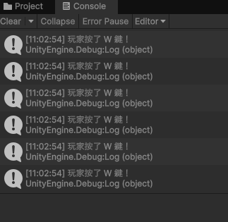
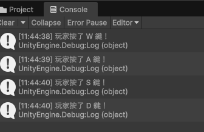

# 第2次練習題目-隨堂-QZ2
>
>學號：113111110 (換成自己的)
><br />
>姓名：吳金洋 (換成自己的)
><br />
>作業撰寫時間：180 (mins，包含程式撰寫時間，換成自己的)
><br />
>最後撰寫文件日期：2026/10/28 (換成自己的)
>

本份文件包含以下主題：(至少需下面兩項，若是有多者可以自行新增)
- [x] 說明內容
- [x] 其他 (可以包含心得或是想跟老師反映)

## 說明內容

開始寫說明，該說明需說明想法，
並於之後再對上述想法的每一部分將程式進一步進行展現，
若需引用程式區則使用下面方法，
若為.cs檔內程式除了於敘述中需註明檔案名稱外，
還需使用語法` ```語言種類 程式碼 ``` `，其中語言種類若是要用python則使用py，java則使用java，C/C++則使用cpp，
下段程式碼為語言種類選擇csharp使用後結果：

```csharp
public void mt_getResult(){
    ...
}
```

若要於內文中標示部分網頁檔，則使用以下標籤` ```html 程式碼 ``` `，
下段程式碼則為使用後結果：

```html
<%@ Page Language="C#" AutoEventWireup="true" ...>

<!DOCTYPE html>

<html xmlns="http://www.w3.org/1999/xhtml">
<head runat="server">
<meta http-equiv="Content-Type" ...>
    <title></title>
</head>
<body>
    <form id="form1" runat="server">
        <div>
        </div>
    </form>
</body>
</html>
```
更多markdown方法可參閱[https://ithelp.ithome.com.tw/articles/10203758](https://ithelp.ithome.com.tw/articles/10203758)

請在撰寫"說明程式與內容"該塊內容，請把原該塊內上述敘述刪除，該塊上述內容只是用來指引該怎麼撰寫內容。

1. 

### 一、程式碼

```csharp
using UnityEngine;
using UnityEngine.InputSystem;

public class PlayerController : MonoBehaviour
{
    void Update()
    {
        Keyboard keyboard = Keyboard.current;

        if (keyboard == null)
        {
            return;
        }

        if (keyboard.wKey.isPressed)
        {
            Debug.Log("玩家按了 W 鍵！");
        }
    }
}
```

### 二、程式碼說明

1. `using UnityEngine;`：引入 Unity 的基本功能。
2. `using UnityEngine.InputSystem;`：引入 Unity 的新輸入系統，用來偵測鍵盤。
3. `public class PlayerController : MonoBehaviour`：建立 PlayerController 類別，並繼承 MonoBehaviour，讓它可以作為 Unity 的元件。
4. `void Update()`：每一幀都會執行的函式。
5. `Keyboard keyboard = Keyboard.current;`：取得目前使用的鍵盤。
6. `if (keyboard == null)`：判斷目前是否沒有可用的鍵盤。
7. `return;`：結束這一次函式的執行，避免沒有鍵盤時繼續偵測。
8. `if (keyboard.wKey.isPressed)`：判斷 W 鍵目前是否正被按住。
9. `Debug.Log("玩家按了 W 鍵！");`：當 W 鍵被按住時，在 Unity 的 Console 印出「玩家按了 W 鍵！」。
10. `{ }`：用來表示程式區塊的開始與結束。

### 三、執行結果

當遊戲執行時，點選 Game 視窗並按住 W 鍵，Console 就會印出：



```text
玩家按了 W 鍵！
```

2. 

### 一、程式碼

```csharp
void Update()
{
    Keyboard keyboard = Keyboard.current;

    if (keyboard == null)
    {
        return;
    }

    if (keyboard.wKey.wasPressedThisFrame)
    {
        Debug.Log("玩家按了 W 鍵！");
    }

    if (keyboard.aKey.wasPressedThisFrame)
    {
        Debug.Log("玩家按了 A 鍵！");
    }

    if (keyboard.sKey.wasPressedThisFrame)
    {
        Debug.Log("玩家按了 S 鍵！");
    }

    if (keyboard.dKey.wasPressedThisFrame)
    {
        Debug.Log("玩家按了 D 鍵！");
    }
}
```

### 二、程式碼說明

1. `if (keyboard.wKey.wasPressedThisFrame)`：判斷 W 鍵是否在目前這一幀剛被按下。
2. `Debug.Log("玩家按了 W 鍵！");`：在 Console 印出「玩家按了 W 鍵！」。
3. `if (keyboard.aKey.wasPressedThisFrame)`：判斷 A 鍵是否在目前這一幀剛被按下。
4. `Debug.Log("玩家按了 A 鍵！");`：在 Console 印出「玩家按了 A 鍵！」。
5. `if (keyboard.sKey.wasPressedThisFrame)`：判斷 S 鍵是否在目前這一幀剛被按下。
6. `Debug.Log("玩家按了 S 鍵！");`：在 Console 印出「玩家按了 S 鍵！」。
7. `if (keyboard.dKey.wasPressedThisFrame)`：判斷 D 鍵是否在目前這一幀剛被按下。
8. `Debug.Log("玩家按了 D 鍵！");`：在 Console 印出「玩家按了 D 鍵！」。
9. `if`：用來判斷指定的條件是否成立。
10. `wasPressedThisFrame`：用來判斷按鍵是否在目前這一幀剛被按下，避免持續按住時重複顯示訊息。
11. `Debug.Log()`：用來在 Unity 的 Console 顯示訊息。

### 三、執行結果

當遊戲執行時，點選 Game 視窗，再分別按住 A、S、D 鍵，Console 會顯示對應的訊息：



```text
玩家按了 W 鍵！
玩家按了 A 鍵！
玩家按了 S 鍵！
玩家按了 D 鍵！
```


## 其他